# ClinPass: Clinical Teaching Operating System

> Learn clinical skills like a game. Practice with a live AI patient, then get structured feedback on how you communicated.

🏆 **Outstanding Pitch Award, TAU Med Hackathon 2026** (Synergy Innovate × TAU Helmsley Medical Simulation Center, challenge: *"Scaling Clinical Teaching: The Future of Medical Education"*).

🌐 **Live demo:** https://clinpass-app.pages.dev
🎬 **Film (2 min):** [watch in the browser](https://clinpass-app.pages.dev/v/film.mp4) · [media/clinpass-film.mp4](media/clinpass-film.mp4)

[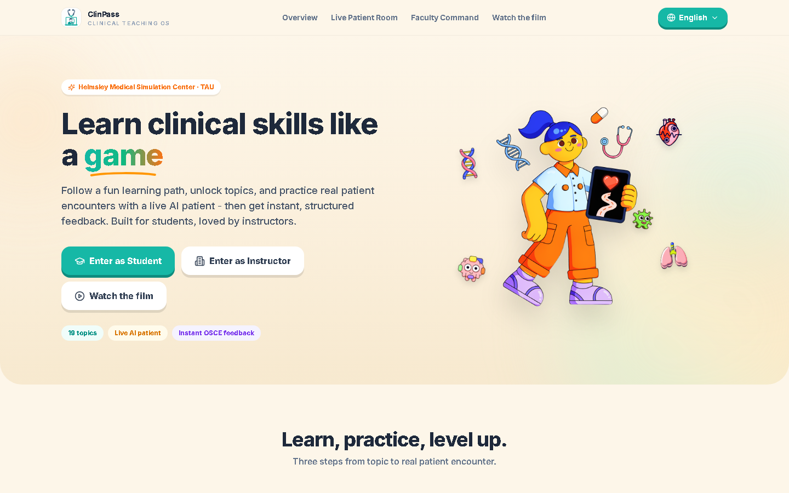](https://clinpass-app.pages.dev)

---

## The problem

Medical school enrollment grows faster than teaching capacity. There are not enough instructors, not enough teaching time, limited patient access and overloaded simulation centers. The result is unequal practice and thin, impersonal feedback. Students arrive at their clinical years less prepared than they could be.

## What ClinPass does

**For students**
1. Pick a hospital department and follow its learning path, topic by topic, with streaks, lives and XP.
2. Warm up with short games, such as pediatric medication practice.
3. Enter the **Live Patient Room**: read the patient's chart, prepare with **Dr. Ester**, an AI clinical mentor shown as a live video avatar, then run the encounter with the AI patient by voice.
4. Get a **Calgary-Cambridge communication report**: a score, strengths, what to focus on next time, and alerts on phrasing that may sound blaming or dismissive.
5. Track progress, see the weakness the system detected and the recommended next case, and compare with the class ranking.

**For instructors**
- Every simulation report in one list, lowest scores first, so the instructor steps in where it matters most.
- A remediation checklist that groups students by weak topic for focused review sessions.
- Cohort insight: who needs support in theory, diagnosis and communication.
- Attendance tracking for teaching sessions.

> Most tools teach cases. ClinPass teaches the learner, supports the instructor and improves the curriculum.

## Screenshots

| Departments | Pediatrics learning path |
|---|---|
| 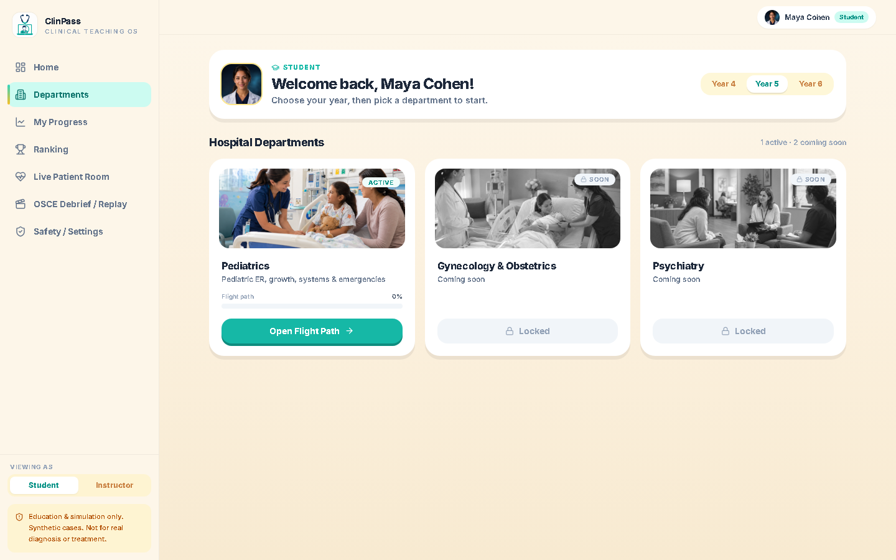 | 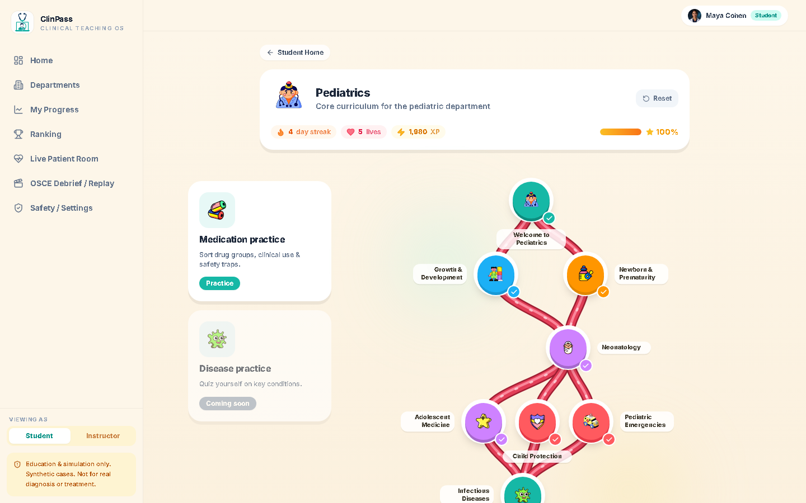 |

| Medication practice | Live Patient Room |
|---|---|
| 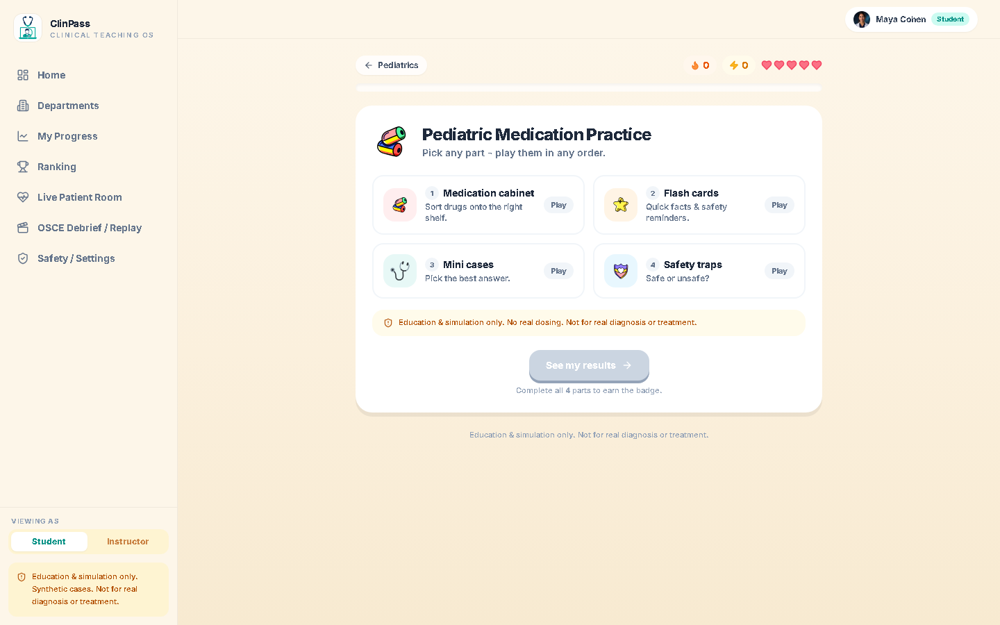 | 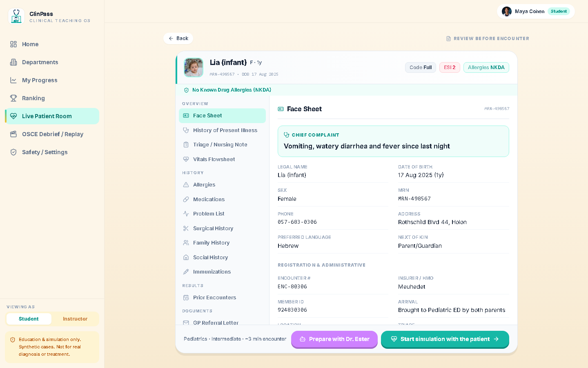 |

| Communication report | Student progress |
|---|---|
| 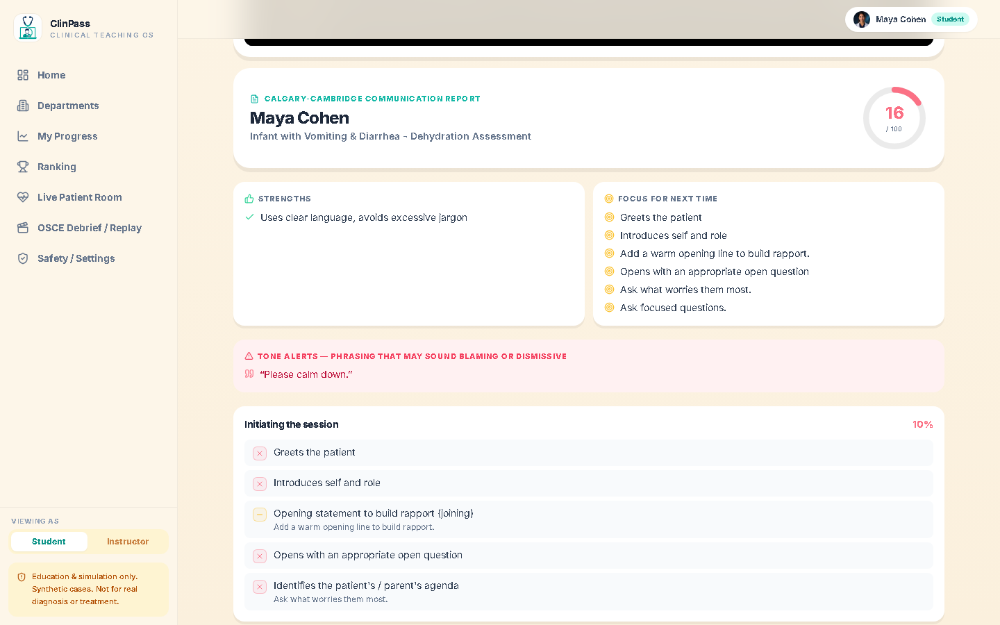 | 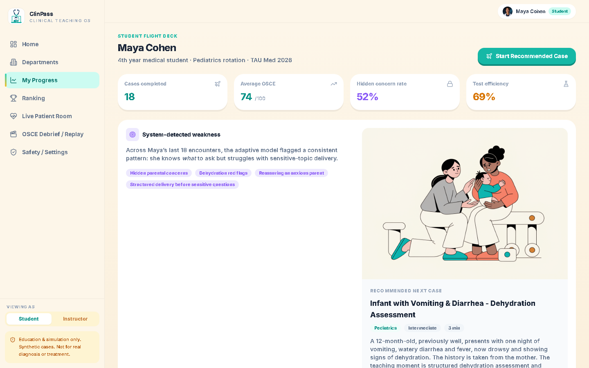 |

| Class ranking | Instructor: simulation reports |
|---|---|
| 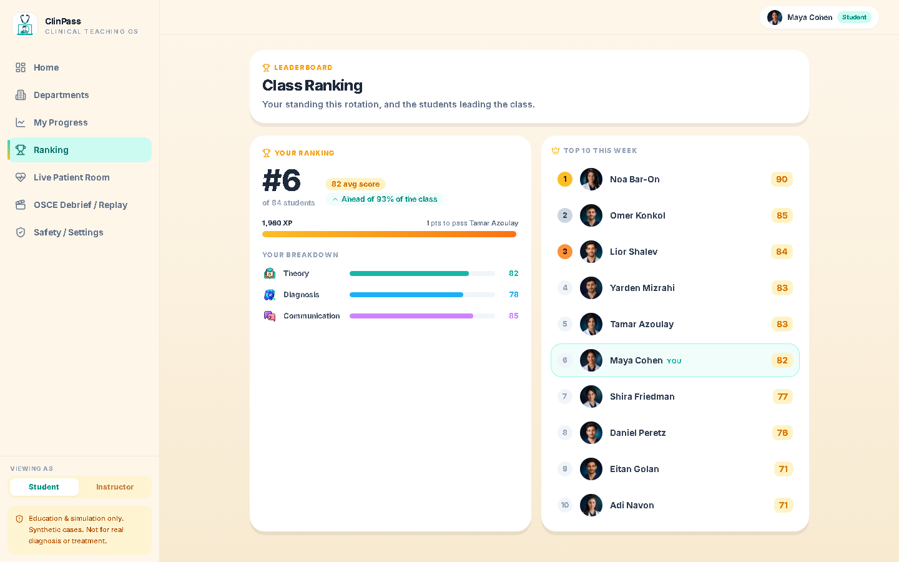 | 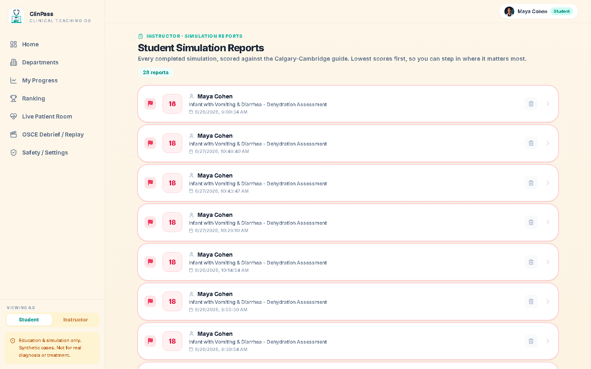 |

| Instructor: remediation checklist | Faculty: cohort insight |
|---|---|
| 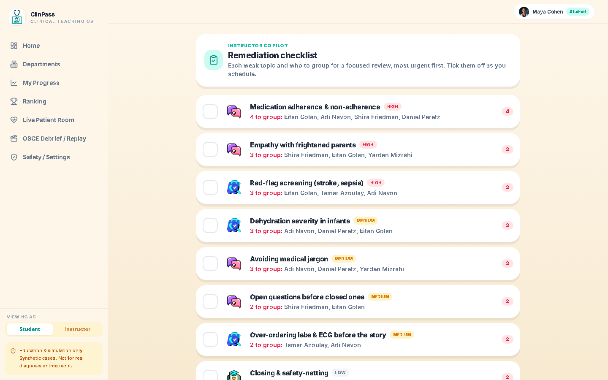 | 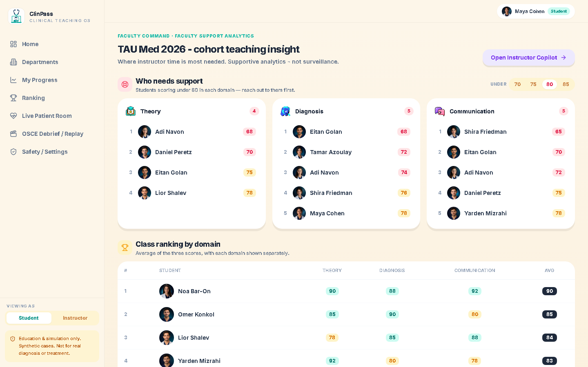 |

## Why it is not just a chatbot

| Engine | What it does |
|---|---|
| **Hidden Concern Engine** | Sensitive information unlocks only with the right topic, tone and timing |
| **Communication Engine** | Scores *how* the student speaks, not only what they ask |
| **Intent Classifier** | Topic and tone detection (judgmental / normalizing / empathic) |
| **Calgary-Cambridge report** | Checks each stage of the consultation and flags phrasing that may sound blaming |
| **Faculty and Instructor Insights** | Cohort gaps, remediation groups, reports sorted by need |

## Tech stack

**Frontend:** Vite, React 18, TypeScript, Tailwind CSS with a custom design system, Radix UI primitives, lucide-react, Framer Motion, Recharts, Zustand, React Router.

**Live AI patient and mentor (Live Patient Room):**
- **HeyGen LiveAvatar** streaming avatar via `@heygen/liveavatar-web-sdk`. A Cloudflare Pages Function (`/api/liveavatar/token`) exchanges the server-side HeyGen API key for a short-lived session token, so the key never reaches the browser.
- **Fallback avatars** when the SDK is unavailable: a 3D talking head (`@met4citizen/talkinghead`) and a photo-based lip-sync avatar driven by the same speech bridge.
- **Speech in the browser:** Web Speech API for recognition with live mic metering, SpeechSynthesis for the patient voice, and a typed fallback that always works.

**Session recording and reports:** MediaRecorder composites the avatar, the student webcam, mixed audio and live captions into one video; `ffmpeg.wasm` for processing; reports and recordings sync to **Cloudflare KV** through Pages Functions (`/api/recordings`), with local storage as fallback.

**Deterministic engines** (no API keys needed for the core loop): intent classifier, patient state machine, hidden-concern state machine, communication scoring, Calgary-Cambridge checklist.

**Hosting:** **Cloudflare Pages** with Pages Functions (avatar token, recordings API, and a range-capable endpoint that streams the film at `/v/film.mp4`).

**Hackathon tooling:** built in 3 days with **Claude Code** (AI-assisted development), **HeyGen** (avatars) and **Higgsfield** (film).

Architecture details: [docs/ARCHITECTURE.md](docs/ARCHITECTURE.md)

## Team and my role

Team of 4 at TAU Med Hackathon 2026. I (Omer Konkol) led the full build of the product: the web application, the engines and the integration of the team's medical ideas into a working prototype in 3 days. The clinical content, the case design and the educational rubric came from the medical students on the team.

## Documentation

- [Product spec](docs/PRODUCT_SPEC.md) (hackathon version)
- [Architecture](docs/ARCHITECTURE.md)
- [Educational rubric](docs/EDUCATIONAL_RUBRIC.md)
- [Pitch script](docs/PITCH_SCRIPT.md)
- [Safety and privacy](docs/SAFETY_AND_PRIVACY.md)
- [Future roadmap](docs/FUTURE_ROADMAP.md)
- [README in Hebrew](README_HE.md)

## Safety and scope

For medical education and simulation only. All cases are synthetic. Not for real patient diagnosis or treatment. AI feedback is formative and requires faculty review for high-stakes assessment. This is a hackathon MVP, not a certified assessment tool.

## Limitations, honestly

- Patient responses and scoring in the core loop are deterministic, rule-based logic tuned for the demo cases, not a general medical model.
- Only the Pediatrics department is open. The other departments are marked "coming soon".
- Student, cohort and ranking data in the dashboards are mock data.
- In the public demo the live simulation is disabled. Use **Watch Demo** inside the Live Patient Room to see an example encounter.

---

Contact: omerkol123@gmail.com · [LinkedIn](https://www.linkedin.com/in/omer-konkol-b7679b3a3) · [GitHub](https://github.com/omerkonkol)
