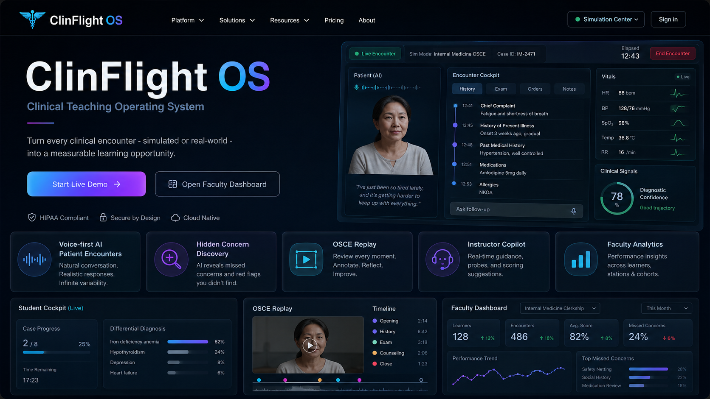
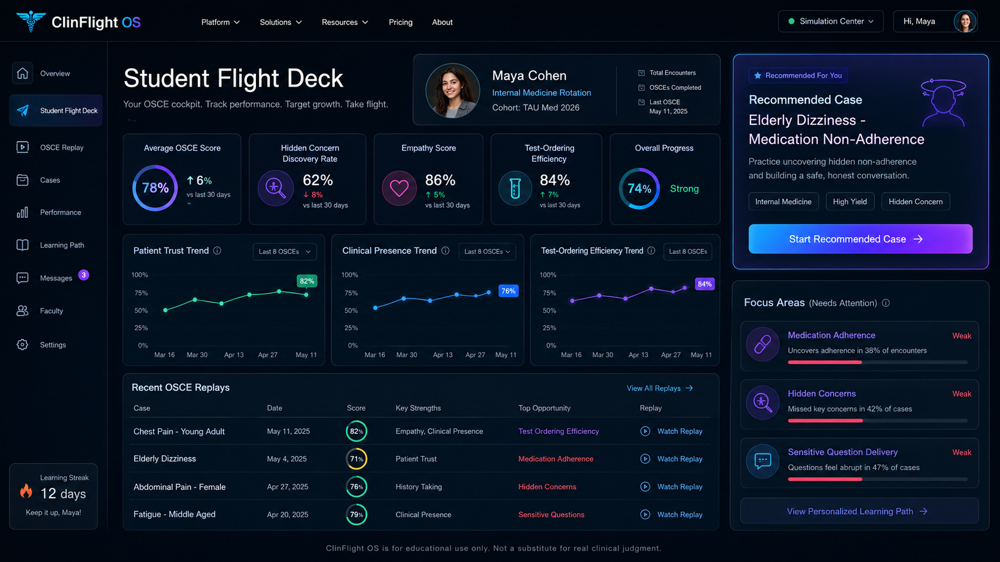
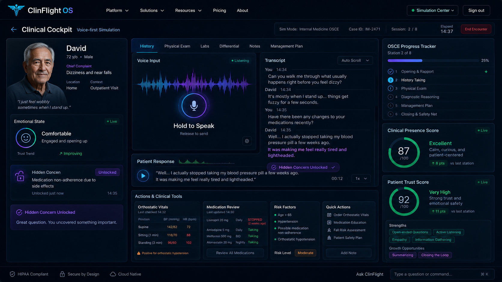
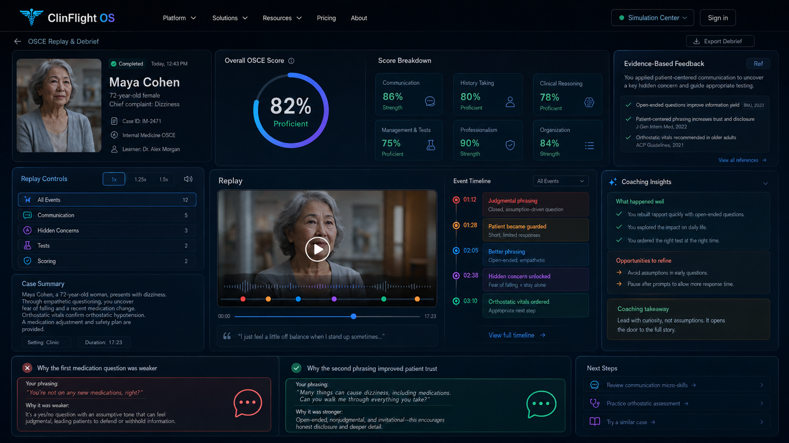
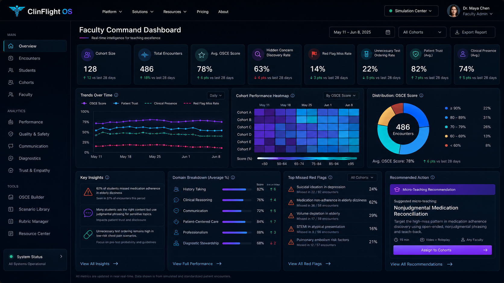
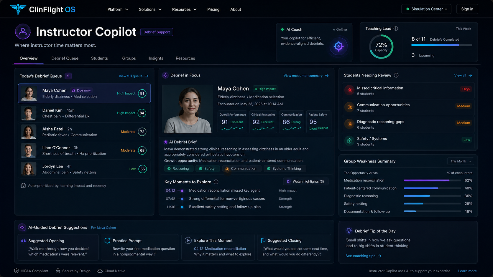
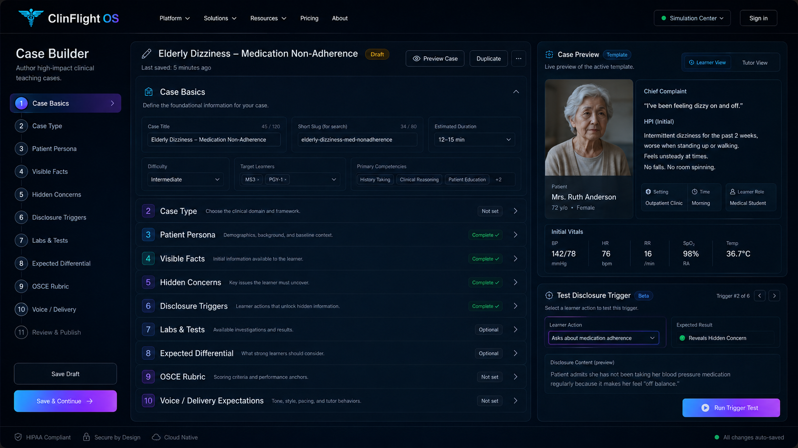

# ClinPass — Clinical Teaching Operating System

> Turn every clinical encounter, simulated or real, into a measurable learning opportunity.

🏆 **Outstanding Pitch Award, TAU Med Hackathon 2026** (Synergy Innovate × TAU Helmsley Medical Simulation Center, challenge: *"Scaling Clinical Teaching: The Future of Medical Education"*).

🌐 **Live demo:** https://clinpass-app.pages.dev
🎬 **Film (2 min):** [watch in the browser](https://clinpass-app.pages.dev/v/film.mp4) · [media/clinpass-film.mp4](media/clinpass-film.mp4)

---

## The problem

Medical school enrollment grows faster than teaching capacity. There are not enough instructors, not enough teaching time, limited patient access and overloaded simulation centers. The result is unequal practice and thin, impersonal feedback. Students arrive at their clinical years less prepared than they could be.

## What ClinPass does

ClinPass is a clinical-reasoning **flight simulator** for students and a teaching **command center** for instructors.

1. The system detects a student's weak clinical skills.
2. It recommends a personalized case.
3. The student practices a voice-first encounter with a live AI patient.
4. Hidden information unlocks only with the right question, the right tone, at the right moment.
5. The student orders vitals, exams, labs and imaging, then submits a differential and a plan.
6. OSCE-style feedback with evidence, then a replay of the decisive moments.
7. The instructor gets a ready debrief guide. Faculty see cohort-level gaps.

> Most tools teach cases. ClinPass teaches the learner, supports the instructor and improves the curriculum.

## Why it is not just a chatbot

| Engine | What it does |
|---|---|
| **Hidden Concern Engine** | Sensitive information unlocks only with the right topic, tone and timing |
| **Communication Engine** | Scores *how* the student speaks: Patient Trust and Clinical Presence |
| **Intent Classifier** | Topic and tone detection (judgmental / normalizing / empathic) |
| **Scoring Engine** | 100-point, 7-domain OSCE rubric with evidence and EPA mapping |
| **Replay Engine** | Reconstructs the decisive moments of the encounter |
| **Faculty and Instructor Insights** | Cohort gaps, debrief guides, teaching-load balancing |

## The learning moment, in one example

Maya (4th year) speaks with David, 72, who came in with dizziness.

- *"Are you taking your medications properly?"* → David becomes guarded. The hidden concern stays locked. Trust drops.
- *"Many people stop or change medications because of side effects, and that is completely understandable. Has anything like that happened recently?"* → David admits he stopped his blood-pressure pill. Hidden concern unlocked. Trust rises.

Same clinical question, two completely different encounters. That difference is what ClinPass measures and teaches.

## Screenshots

| Student Flight Deck | Clinical Cockpit |
|---|---|
|  |  |

| OSCE Replay and Debrief | Faculty Command |
|---|---|
|  |  |

| Instructor Copilot | Case Builder |
|---|---|
|  |  |

## Tech stack

- **Vite + React 18 + TypeScript**, Tailwind CSS with a custom clinical design system
- Radix UI primitives, lucide-react icons, Recharts analytics, Framer Motion
- Zustand for session state
- Deterministic local engines for the core loop (intent, patient, hidden concern, scoring, replay), so the demo runs reliably without API keys
- Live AI patient layer built with **Claude Code**, **HeyGen** (avatar) and **Higgsfield** (video), during the 3-day hackathon
- Deployed on **Cloudflare Pages** with Pages Functions for the film endpoint and session recordings (KV)

Architecture details: [docs/ARCHITECTURE.md](docs/ARCHITECTURE.md)

## Team and my role

Team of 4 at TAU Med Hackathon 2026. I (Omer Konkol) led the full build of the product: the web application, the engines and the integration of the team's medical ideas into a working prototype in 3 days. The clinical content, the case design and the educational rubric came from the medical students on the team.

## Documentation

- [Product spec](docs/PRODUCT_SPEC.md)
- [Architecture](docs/ARCHITECTURE.md)
- [Educational rubric](docs/EDUCATIONAL_RUBRIC.md)
- [Demo script](docs/DEMO_SCRIPT.md) and [pitch script](docs/PITCH_SCRIPT.md)
- [Design system](docs/DESIGN_SYSTEM.md)
- [Safety and privacy](docs/SAFETY_AND_PRIVACY.md)
- [Future roadmap](docs/FUTURE_ROADMAP.md)
- [README in Hebrew](README_HE.md)

## Safety and scope

For medical education and simulation only. All cases are synthetic. Not for real patient diagnosis or treatment. AI feedback is formative and requires faculty review for high-stakes assessment. This is a hackathon MVP, not a certified assessment tool.

## Limitations, honestly

- Patient responses and scoring in the core loop are deterministic, rule-based logic tuned for the demo cases, not a general medical model.
- Voice recognition uses the browser Web Speech API when available, with a typed fallback that always works.
- Cohort, instructor and progress data in the dashboards are mock data.
- In the public demo the live simulation is disabled. Use **Watch Demo** inside the Live Patient Room to see an exemplary encounter.

---

Contact: omerkol123@gmail.com · [LinkedIn](https://www.linkedin.com/in/omer-konkol-b7679b3a3) · [GitHub](https://github.com/omerkonkol)
